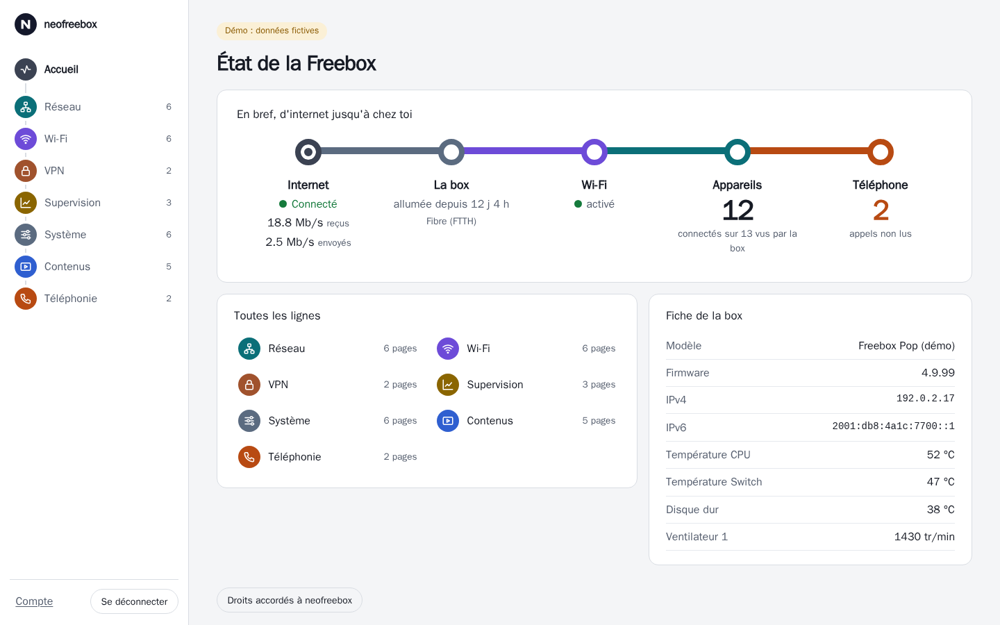
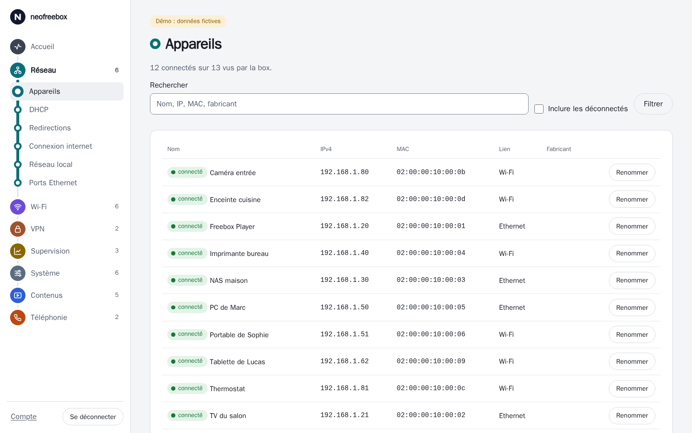
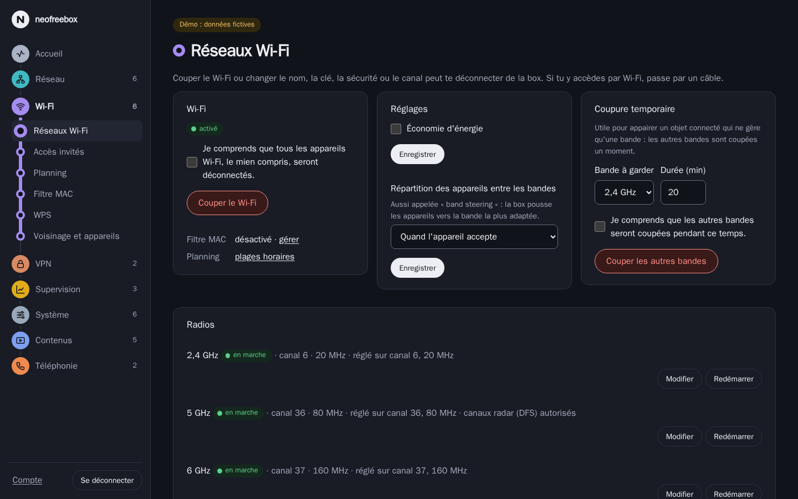
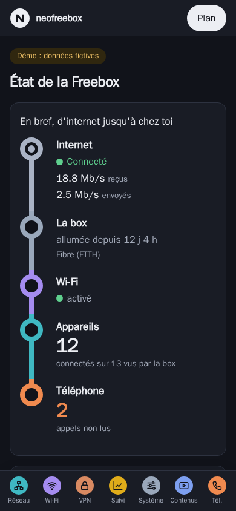

<div align="center">


# neofreebox

**Un panneau de contrôle rapide et auto-hébergé pour la Freebox Pop.**

Tout ce que fait l'interface web de Freebox OS, via l'API officielle,
dans une petite application que tu fais tourner sur ton propre serveur.

[](https://github.com/neotoxicfr/neofreebox/actions/workflows/pr.yml)
[](LICENSE)
[](https://github.com/neotoxicfr/neofreebox/releases)

</div>

<p align="center">
  <picture>
    <source media="(prefers-color-scheme: dark)" srcset="docs/screenshots/accueil-sombre.png">
    
  </picture>
</p>

<p align="center">
  
  
  
</p>

<p align="center"><sub>Captures faites en mode démo (<code>NEOFREEBOX_DEMO=true</code>) : toutes les données sont fictives.</sub></p>

> [!WARNING]
> **Version préliminaire.** Toutes les sections de Freebox OS sont couvertes,
> mais toutes les écritures n'ont pas encore été essayées sur une vraie box.
> Le mode lecture seule (`NEOFREEBOX_READ_ONLY=true`) permet de tout parcourir sans risque.

## Pourquoi neofreebox

L'interface de Freebox OS est une grosse application monopage (plusieurs mégaoctets
de JavaScript) qui devient lente et capricieuse dès qu'on la place derrière un
reverse proxy pour y accéder de l'extérieur. neofreebox s'appuie sur la même API
officielle, mais génère ses pages côté serveur et laisse au navigateur le strict minimum :

- **Rapide partout** : pages HTML simples, une seule feuille de style, un script minuscule, pas d'étape de build.
- **Sûr à exposer** : sa propre connexion, pensée pour se placer derrière un reverse proxy
  qui authentifie, et le jeton d'application de la box ne quitte jamais le serveur.
- **Prudent avec ton réseau** : tout ce qui peut te couper la connexion (Wi-Fi, DHCP,
  mode pont, redémarrage) demande une confirmation avant d'être envoyé.
- **Pilotable par script ou par IA** : une API JSON et un serveur MCP exposent environ 340 opérations.

## Fonctions

Le menu reprend les groupes suivants.

| Groupe | Pages |
| --- | --- |
| **Freebox** | État de la box |
| **Réseau** | Appareils, DHCP, redirections de ports (NAT, DMZ), connexion internet (IPv6, DynDNS), réseau local, ports Ethernet |
| **Wi-Fi** | Réseaux Wi-Fi, accès invités, planning, WPS, filtre MAC, voisinage et stations |
| **VPN** | Serveur VPN (pairs WireGuard, fichiers de configuration et QR codes), client VPN |
| **Supervision** | Historiques (graphiques), Freeplugs, diagnostic |
| **Système** | Box (redémarrage, mises à jour), veille, contrôle parental, écran et voyants, players, disques |
| **Contenus** | Téléchargements, fichiers (parcourir, télécharger, liens de partage), partages (SMB, AFP, FTP, TFTP, UPnP AV, AirMedia), chaînes et guide TV, enregistrements |
| **Téléphonie** | Journal d'appels, répondeur, contacts |

Pas encore là : les mises à jour en temps réel (événements WebSocket de la box) et
l'envoi de fichiers (la box ne le propose qu'en WebSocket).

## API et MCP

Chaque opération de l'interface est aussi disponible en JSON et en outil MCP. Crée un
jeton dans la page **Compte** de neofreebox (il n'est affiché qu'une fois ; seule son
empreinte est conservée), puis :

```bash
# Lister les opérations (nom, description, arguments)
curl -H "Authorization: Bearer nfb_xxx" https://box.example.com/api/v1/ops

# Lancer une opération de lecture
curl -X POST -H "Authorization: Bearer nfb_xxx" \
  https://box.example.com/api/v1/ops/wifi_config_get

# Une opération dangereuse (coupure possible) exige "confirm": true
curl -X POST -H "Authorization: Bearer nfb_xxx" -H "Content-Type: application/json" \
  -d '{"confirm": true}' https://box.example.com/api/v1/ops/<operation>
```

Le serveur MCP (HTTP, sans état) écoute sur `/mcp` avec le même jeton. Exemple de
configuration d'un client :

```json
{
  "mcpServers": {
    "neofreebox": {
      "type": "http",
      "url": "https://box.example.com/mcp",
      "headers": { "Authorization": "Bearer nfb_xxx" }
    }
  }
}
```

Les outils en lecture seule sont signalés comme tels ; les outils dangereux sont
marqués « destructifs » et refusés tant que `confirm` n'est pas à `true`.

## Prérequis

- Une Freebox avec l'API Freebox OS (testé sur une Freebox Pop, API v16).
- Un serveur Docker sur le réseau local de la box : elle ne répond que depuis ce réseau.
- Un reverse proxy en HTTPS devant neofreebox (Traefik, Caddy…), idéalement avec sa
  propre authentification (Authelia, Authentik…). Le cookie de session est `Secure`.

## Démarrer

1. **Appairer l'application**, une seule fois, depuis une machine du réseau local de la box.
   La demande s'affiche sur l'écran du dessus de la Freebox Pop (allume-le s'il est éteint) :
   valide-la là, dans la minute ou deux qui suivent.

   L'image tourne sans privilèges (UID 65532) : donne-lui d'abord les dossiers montés.

   ```bash
   mkdir -p secrets data
   sudo chmod 0700 secrets data && sudo chown 65532:65532 secrets data
   docker run --rm -it -v "$PWD/secrets:/out" ghcr.io/neotoxicfr/neofreebox:latest \
     pair -o /out/freebox_app_token
   ```

2. **Cocher les droits** dans Freebox OS : Paramètres de la Freebox, Gestion des accès,
   Applications, neofreebox. Une nouvelle application n'en reçoit que quelques-uns par
   défaut ; coche ceux dont tu as besoin (tous, pour tout piloter).
3. **Lancer** avec [`deploy/compose.yml.example`](deploy/compose.yml.example) (copie-le en
   `docker-compose.yml`). La commande `docker compose run --rm neofreebox check` affiche les
   droits obtenus.
4. **Créer le compte** : ouvre l'application et saisis le code d'installation affiché dans le
   journal du conteneur (`docker logs neofreebox`).

**Essayer sans box** : `docker run --rm -p 8080:8080 -e NEOFREEBOX_DEMO=true ghcr.io/neotoxicfr/neofreebox:latest`,
puis ouvre <http://localhost:8080> (compte `demo` / `demo-neofreebox`). Les données sont
fictives, aucune box n'est contactée et les modifications sont sans effet.

### Variables d'environnement

| Variable | Défaut | Rôle |
| --- | --- | --- |
| `NEOFREEBOX_APP_TOKEN_FILE` | — | fichier contenant le jeton d'application (obligatoire) |
| `NEOFREEBOX_BOX_URL` | `https://mafreebox.freebox.fr` | adresse de la box |
| `NEOFREEBOX_DATA_DIR` | `/data` dans l'image (`./data` sinon) | dossier du compte et des jetons d'API |
| `NEOFREEBOX_ADDR` | `:8080` | adresse d'écoute |
| `NEOFREEBOX_READ_ONLY` | `false` | `true` : refuse toute écriture vers la box (démonstration, audit sur une vraie box) |
| `NEOFREEBOX_DEMO` | `false` | `true` : fausse box intégrée, données fictives, compte `demo` / `demo-neofreebox` (rien n'est écrit dans le dossier de données) |

## Sécurité

Le jeton d'application a tous les droits sur la box : neofreebox a donc son propre compte
unique (créé avec un code à usage unique), des sessions en cookies `HttpOnly`/`Secure`,
des jetons d'API stockés sous forme d'empreinte SHA-256, un limiteur de tentatives de
connexion, et il tourne dans une image distroless, non root, en lecture seule. Le jeton de
la box n'est jamais envoyé au navigateur ni écrit dans les journaux. Le détail, y compris
comment signaler une faille en privé, est dans [SECURITY.md](SECURITY.md).

## Comment c'est fait

- Un seul binaire Go avec les modèles HTML, la feuille de style et le script embarqués ;
  aucune base de données, puisque l'état vit sur la box.
- `internal/fbx` : client de l'API Freebox OS (appairage, sessions par défi HMAC-SHA1
  renouvelées à l'expiration). La box est jointe en HTTPS avec les certificats racine de Free embarqués.
- `internal/ops` : catalogue des opérations, partagé par l'API JSON et le serveur MCP.
- `internal/server` : une page par module, rendue côté serveur (`html/template`).
- L'image est `distroless/static`, non root, avec un système de fichiers en lecture seule.

## Contribuer

Les contributions sont bienvenues : lis [CONTRIBUTING.md](CONTRIBUTING.md) pour compiler,
tester et proposer une modification, et [CODE_OF_CONDUCT.md](CODE_OF_CONDUCT.md) pour l'esprit
du projet. Un bug ou une idée : ouvre une [issue](https://github.com/neotoxicfr/neofreebox/issues/new/choose).

## Licence

[GPL-3.0](LICENSE). neofreebox n'a aucun lien avec Free ni Iliad.
